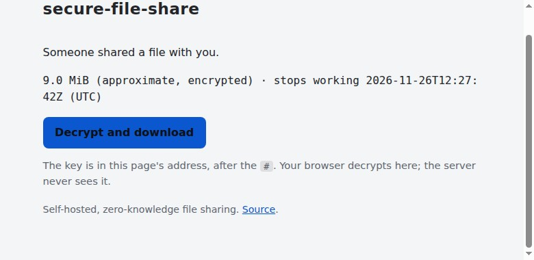
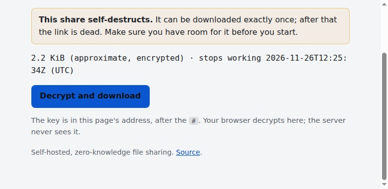

# secure-file-share

Share one file with one link. The browser encrypts, the server stores
ciphertext, and the key lives in the link's `#fragment` — the one part of a
URL that is never sent to a server.





## What the server can never know

| | Browser upload | URL import |
|---|---|---|
| File name, MIME type | encrypted, frame 0 | encrypted, frame 0 |
| File bytes | encrypted in the browser | transits the server once (it fetched them) |
| Key | never leaves the browser, handed over in `#key=` | generated by the server, handed over in `#key=` |
| What Postgres holds | ciphertext only | ciphertext only |

A browser upload is zero-knowledge end to end: the server parses *lengths*,
not plaintext, and an admin listing shows sizes and timestamps and nothing
else. A URL import is the server doing the browser's job for a file that is
not on this machine — the plaintext passes through the process exactly once,
on purpose, and the database still never sees it. Pick uploads when you can,
imports when the file lives somewhere only the server can reach.

Everything that makes a share die is enforced at read time, not by cron:
expiry is checked in every claim, and a burn-after-reading share is claimed
in one atomic statement, so two racing downloads can never both win.

## The format (it is small on purpose)

```text
plaintext   [ metadata JSON <= 64 KiB ] [ data, 4 MiB chunks ] ...
chunk       nonce (12) || AES-256-GCM ciphertext || tag (16)
frame       u32 big-endian length || chunk
end         an empty chunk — truncation fails the tag, not the download
key         256-bit random, base64url, in the URL fragment
```

Chunked GCM means a 512 MiB video never sits whole in browser memory, and
the database stores one row per chunk (`share_chunks`), streamed back in
order, so the server holds a few megabytes at a time no matter the share
size. The whole wire format is duplicated in ~100 lines of dependency-free
JavaScript and ~60 lines of Rust, and the integration tests encrypt and
decrypt through both.

## Deployment shape

One stateless container plus one Postgres. No PVC, no local disk, no
background jobs beyond an hourly sweeper that only *reclaims* storage
(expiry itself never waits for it). In production it runs as a single
replica on a Talos cluster behind Traefik, with a CloudNativePG Postgres 18
cluster and its backups; `compose.yaml` gives you the same shape locally
with a throwaway database.

```bash
docker compose up --build   # -> http://localhost:8080
```

`localhost` is a secure context, so the browser-side WebCrypto works out of
the box.

### Configuration (environment only, defaults in parentheses)

| Variable | Meaning |
|---|---|
| `DATABASE_URL` | Postgres DSN, required. The CloudNativePG app secret with `sslmode=disable` appended. |
| `SFS_ADMIN_TOKEN` | Bearer token for every write path, required, 16+ chars. Compared in constant time. |
| `SFS_BASE_URL` | The origin share links are built against, required (`https://secure-share.yornik.eu` in production). |
| `SFS_LISTEN_ADDR` / `SFS_METRICS_ADDR` | Two listeners: public web and Prometheus (`0.0.0.0:8080` / `0.0.0.0:9090`). Metrics never sit behind the ingress. |
| `SFS_MAX_UPLOAD_BYTES` | Stored-ciphertext ceiling per share (512 MiB), enforced frame by frame. |
| `SFS_IMPORT_MAX_BYTES` | Plaintext ceiling for a URL import (512 MiB). |
| `SFS_DEFAULT_TTL_DAYS` / `SFS_MAX_TTL_DAYS` | Lifetime clamps (7 / 90). An absurd requested TTL clamps, it does not fail. |
| `SFS_SWEEP_SECS` | Reclamation sweep interval (3600). |

### API (all writes need `Authorization: Bearer <token>`)

```text
POST   /api/v1/shares        encrypted frame stream + X-SFS-One-Time, X-SFS-Ttl-Days
POST   /api/v1/shares/url     {"url": "...", "ttl_days": 7, "one_time": false}
GET    /api/v1/shares         listing: sizes and timestamps, never names
DELETE /api/v1/shares/{id}    revoke
GET    /s/{id}                the page that decrypts
GET    /s/{id}/meta           one_time / burned / stored_size / expires_at
GET    /s/{id}/blob           the ciphertext, streamed
```

## Building

With Rust 1.100 or later:

```bash
cargo build --release
cargo test                    # integration tests need SFS_TEST_DATABASE_URL, else they skip
cargo clippy --all-targets -- -D warnings
```

The Docker image is a musl static build on `scratch`, unprivileged
(`65532:65532`), with the CA bundle the URL importer needs. CI builds it on
every PR without pushing; the release workflow pushes to
`ghcr.io/yornik/secure-file-share`, signs it with keyless cosign, verifies
the signature the way a third party would, and attaches the SBOM to the
release. Renovate keeps every dependency — crates, actions, base images,
digests — current and auto-merges once CI is green.

## Threat model, honestly

- **The operator is trusted.** There is one admin token and no accounts;
  anyone holding it can create, list and revoke shares.
- **The database is trusted with ciphertext, not plaintext.** A leaked
  database dump contains file names nowhere — not even hashed — and bytes
  that need the key in the link.
- **A URL import degrades the guarantee on purpose** (see the table above).
  If the source is only trustworthy to the server (a tailnet metube
  instance, say), that is exactly the point; if you would not let the
  server see it, download it yourself and upload from the browser.
- **No rate limiting is built in** (v0.1); the deployment leans on the
  Traefik fail2ban middleware in front of it. Ids are 128 bits, so walking
  the share list is not a strategy.
- **HTTPS is required for the browser half** — WebCrypto needs a secure
  context; behind Traefik that is already true.

## Licence

MIT — see [LICENSE](LICENSE).
