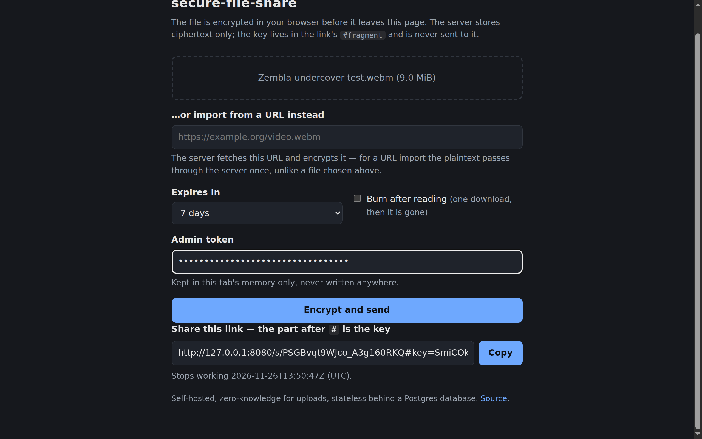
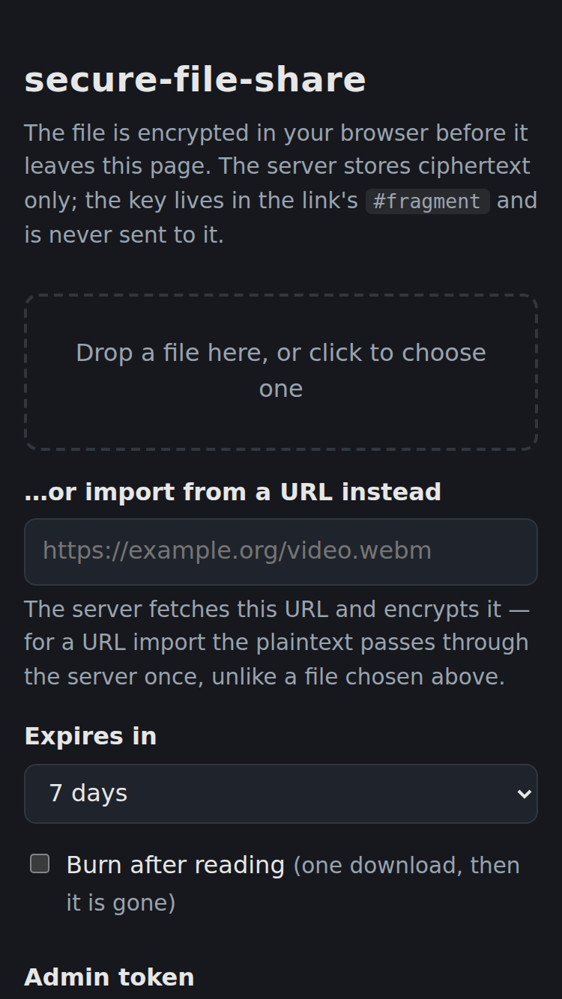
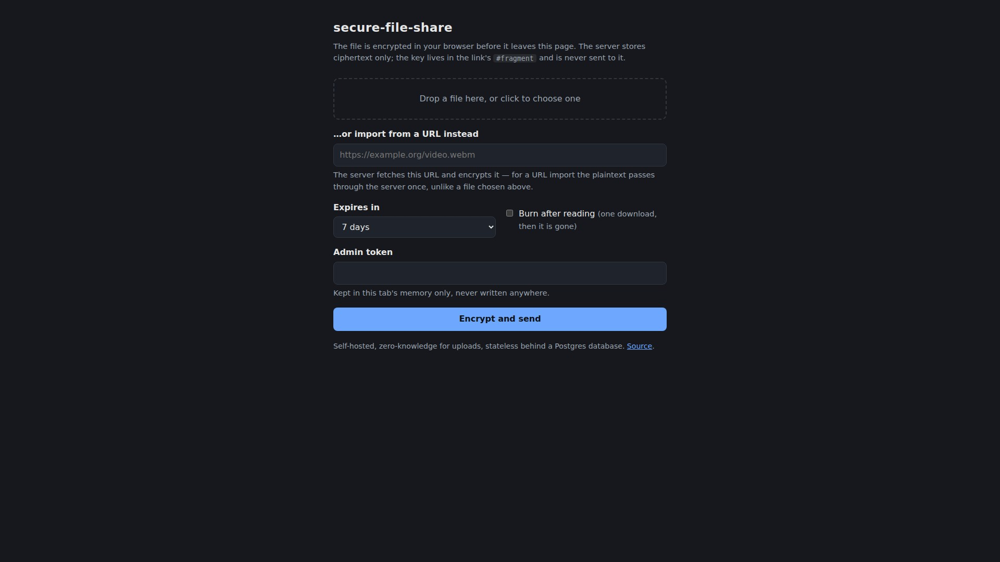

# secure-file-share

Share one file with one link. The browser encrypts, the server stores
ciphertext, and the unlock material lives in the link's `#fragment` — the
one part of a URL that is never sent to a server. The key itself is a
**hybrid post-quantum** construction: an ML-KEM-1024 encapsulation fused
with a 256-bit random value, so an attacker needs *both* to fall.





The same page on a phone and on a wide desktop — one stylesheet, no
framework, nothing loaded from a CDN:




## What the server can never know

| | Browser upload | URL import |
|---|---|---|
| File name, MIME type | encrypted, frame 1 | encrypted, frame 1 |
| File bytes | encrypted in the browser | transits the server once (it fetched them) |
| Key | never leaves the browser, handed over in `#key=` | generated by the server, handed over in `#key=` |
| What the volume holds | ciphertext only | ciphertext only |
| What Postgres holds | sizes and timestamps, nothing else | sizes and timestamps, nothing else |

A browser upload is zero-knowledge end to end: the server parses *lengths*,
not plaintext, and an admin listing shows sizes and timestamps and nothing
else. A URL import is the server doing the browser's job for a file that is
not on this machine — the plaintext passes through the process exactly once,
on purpose, and neither the database nor the volume ever sees it.
Pick uploads when you can, imports when the file lives somewhere only the
server can reach.

Everything that makes a share die is enforced at read time, not by cron:
expiry is checked in every claim, and a burn-after-reading share is claimed
in one atomic statement, so two racing downloads can never both win.

## The format (it is small on purpose)

```text
encapsulation   ML-KEM-1024 ciphertext, raw 1568 bytes, frame 0
plaintext       [ metadata JSON <= 64 KiB: name (<= 120 chars), mime, size ]
                [ data, 4 MiB chunks ] ...
chunk           nonce (12) || AES-256-GCM ciphertext || tag (16)
frame           u32 big-endian length || chunk
end             an empty chunk — truncation fails the tag, not the download
unlock          base64url( keygen seed 64 || random 32 ), in the URL fragment
file key        HKDF-SHA256( mlkem shared secret || random value )
```

The uploader generates a fresh ML-KEM-1024 keypair *from a 64-byte seed*
and encapsulates against it; the recipient regenerates the same keypair
from the same seed and decapsulates. The shared secret and a separate
256-bit random value feed an HKDF-SHA256 derivation, and the result keys
the AES-256-GCM chunks. Breaking ML-KEM-1024 still leaves a 256-bit random
value to brute-force, and vice versa — the same "both must break" shape
the browser vendors use for X25519+ML-KEM hybrids. Without a recipient
keypair there is no key exchange to attack here, so the quantum-relevant
claim lands honestly on the encapsulation plus the symmetric core, both at
a 128-bit-quantum floor or better.

Storage is two places, each doing what it is good at: the ciphertext is
one file per share on a volume (`<id>.sfs`, byte-identical to the wire
format, written to a temporary name and renamed only after the whole
stream validates and fsyncs), while Postgres keeps the bookkeeping — one
row per share, sizes and expiry and claims, never a byte of payload and
never a file name. The blob ceiling is therefore what the volume can
carry, not what is healthy to ask of a database row.

Chunked GCM means a 2 GiB video never sits whole in browser memory, and
the server streams the blob in 64 KiB pieces, so it holds a few dozen
kilobytes at a time no matter the share size. The whole wire format is
duplicated in ~100 lines of dependency-free JavaScript on top of a vendored
[noble](https://paulmillr.com/noble/) post-quantum bundle (MIT,
[THIRD_PARTY_NOTICES.md](THIRD_PARTY_NOTICES.md)) and ~60 lines of Rust,
and the integration tests encrypt and decrypt through both.

## Deployment shape

One stateless container, one small volume for blobs, one Postgres for
bookkeeping. Beyond an hourly sweeper that only *reclaims* storage
(expiry itself never waits for it) there are no background jobs. In
production it runs as a single replica on a Talos cluster behind Traefik,
with a CloudNativePG Postgres 18 cluster and its backups;
`compose.yaml` gives you the same shape locally with a throwaway database
and a named volume for the blobs.

```bash
docker compose up --build   # -> http://localhost:8080
```

`localhost` is a secure context, so the browser-side WebCrypto works out of
the box.

### Configuration (environment only, defaults in parentheses)

| Variable | Meaning |
|---|---|
| `DATABASE_URL` | Postgres DSN, required. The CloudNativePG app secret with `sslmode=disable` appended. |
| `SFS_ADMIN_TOKEN` | Bearer token for every write path, required, 16+ chars. Compared in constant time. |
| `SFS_BASE_URL` | The origin share links are built against, required (`https://secure-share.yornik.eu` in production). |
| `SFS_DATA_DIR` | Where the ciphertext blobs live (`/var/lib/secure-file-share`). Mount a volume here; it is the only writable path the service needs. |
| `SFS_LISTEN_ADDR` / `SFS_METRICS_ADDR` | Two listeners: public web and Prometheus (`0.0.0.0:8080` / `0.0.0.0:9090`). Metrics never sit behind the ingress. |
| `SFS_MAX_UPLOAD_BYTES` | Stored-ciphertext ceiling per share (2 GiB), enforced frame by frame. |
| `SFS_IMPORT_MAX_BYTES` | Plaintext ceiling for a URL import (2 GiB). |
| `SFS_DEFAULT_TTL_DAYS` / `SFS_MAX_TTL_DAYS` | Lifetime clamps (7 / 90). An absurd requested TTL clamps, it does not fail. |
| `SFS_SWEEP_SECS` | Reclamation sweep interval (3600). |

### API (all writes need `Authorization: Bearer <token>`)

```text
POST   /api/v1/shares        encrypted frame stream + X-SFS-One-Time, X-SFS-Ttl-Days
POST   /api/v1/shares/url     {"url": "...", "ttl_days": 7, "one_time": false}
GET    /api/v1/shares         listing: sizes and timestamps, never names
DELETE /api/v1/shares/{id}    revoke
GET    /s/{id}                the page that decrypts
GET    /s/{id}/meta           one_time / burned / stored_size / expires_at
GET    /s/{id}/blob           the ciphertext, streamed
```

## Building

With Rust 1.100 or later:

```bash
cargo build --release
cargo test                    # integration tests need SFS_TEST_DATABASE_URL, else they skip
cargo clippy --all-targets -- -D warnings
```

The integration suite runs single-threaded (`--test-threads=1`): every
test's setup wipes the shared test database, and one serialized database
beats flaky checks. The tests exercise the full post-quantum round-trip —
encapsulate, encrypt, upload, claim, stream down, decapsulate, decrypt —
against a real Postgres and a real blob directory.

The Docker image is a musl static build on `scratch`, unprivileged
(`65532:65532`), with the CA bundle the URL importer needs. CI builds it on
every PR without pushing; the release workflow pushes to
`ghcr.io/yornik/secure-file-share`, signs it with keyless cosign, verifies
the signature the way a third party would, and attaches the SBOM to the
release. Renovate keeps every dependency — crates, actions, base images,
digests — current and auto-merges once CI is green.

## Threat model, honestly

- **The operator is trusted.** There is one admin token and no accounts;
  anyone holding it can create, list and revoke shares.
- **The database is trusted with bookkeeping, the volume with ciphertext.**
  A leaked database dump contains file names nowhere — not even hashed —
  and a leaked volume contains bytes that need the unlock material in the
  link, which no server ever saw.
- **A URL import degrades the guarantee on purpose** (see the table above).
  If the source is only trustworthy to the server (a tailnet metube
  instance, say), that is exactly the point; if you would not let the
  server see it, download it yourself and upload from the browser.
- **No rate limiting is built in** (v0.1); the deployment leans on the
  Traefik fail2ban middleware in front of it. Ids are 128 bits, so walking
  the share list is not a strategy.
- **HTTPS is required for the browser half** — WebCrypto needs a secure
  context; behind Traefik that is already true.

## Licence

MIT — see [LICENSE](LICENSE). The vendored `static/pq.js` bundle is MIT
from Paul Miller; see [THIRD_PARTY_NOTICES.md](THIRD_PARTY_NOTICES.md).
