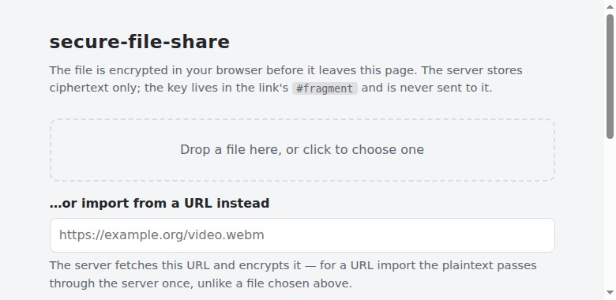

# secure-file-share

secure-file-share puts one file behind one link. The browser encrypts the
file. The server stores ciphertext only. The unlock material stays in the
link fragment (`#key=`). Browsers do not send a fragment to a server.

The unlock material is a **hybrid post-quantum** key. An ML-KEM-1024
encapsulation and a 256-bit random value go through HKDF-SHA256 together.
Both must break before the file key falls.

[](https://github.com/Yornik/secure-file-share/actions/workflows/ci.yml)
[](https://github.com/Yornik/secure-file-share/releases)
[](LICENSE)
[](https://www.rust-lang.org/)
[](https://github.com/Yornik/secure-file-share/pkgs/container/secure-file-share)
[](https://github.com/Yornik/secure-file-share/security)
[](.github/renovate.json)




## What the server does not know

| | Browser upload | URL import |
|---|---|---|
| File name, MIME type | encrypted, frame 1 | encrypted, frame 1 |
| File bytes | encrypted in the browser | the server fetches them once |
| Unlock material | stays in the browser | the server makes it and returns it |
| Volume contents | ciphertext only | ciphertext only |
| Database contents | sizes and times only | sizes and times only |

A browser upload is zero-knowledge. The server reads frame lengths only.
An admin listing shows sizes and times. The listing shows nothing else.

A URL import is different. The plaintext passes through the server process
one time. The database and the volume do not see the plaintext. Use a URL
import only when the server alone can reach the source.

A share dies at read time, not on a schedule. The claim checks the expiry
in the same statement that counts the download. Two racing downloads of a
one-time share can not both win.

## The format

```text
frame 0       ML-KEM-1024 ciphertext, raw, 1568 bytes
frame 1       encrypted metadata: name (<= 120 chars), MIME type, size
frames 2..n   encrypted data, 4 MiB of plaintext each
last frame    an empty encrypted chunk
chunk         nonce (12) || AES-256-GCM ciphertext || tag (16)
frame         u32 big-endian length || chunk
unlock        base64url( keygen seed 64 || random 32 ), in the fragment
file key      HKDF-SHA256( ML-KEM shared secret || random value )
```

The uploader makes an ML-KEM-1024 keypair from a 64-byte seed. The
uploader encapsulates against this keypair. The recipient regenerates the
same keypair from the same seed. The recipient decapsulates and gets the
file key. A wrong seed gives a wrong key. The tag check then fails.

The file key is hybrid. An attacker must break ML-KEM-1024 and must also
guess the 256-bit random value. One break is not sufficient. Browser
vendors use the same "both must break" shape for their X25519+ML-KEM
hybrids.

The last frame is an empty chunk. A truncated stream does not carry this
marker. The tag check fails and the download stops.

## Storage

The ciphertext is one file per share on a volume: `<id>.sfs`. The writer
spools the file to a temporary name first. The file becomes a share only
after the full stream is valid and synced. The writer then renames the
file and commits the row. A crash leaves only a temporary file. The
sweeper removes temporary files after one hour.

The database keeps one row per share. The row holds sizes, times and claim
counters. The row does not hold a file name. The row does not hold
payload bytes.

The volume, not the database, sets the size limit. The default cap is
2 GiB of ciphertext per share.

Chunked GCM keeps browser memory small: the browser holds one 4 MiB chunk
at a time. The server streams the blob in 64 KiB pieces. The server holds
a few kilobytes at a time.

The JavaScript in `static/` implements the same format. It uses a vendored
[noble](https://paulmillr.com/noble/) post-quantum bundle (MIT, see
[THIRD_PARTY_NOTICES.md](THIRD_PARTY_NOTICES.md)). The integration tests
encrypt and decrypt through both sides.

## Deploy

The service is one container, one volume and one Postgres database. One
hourly sweeper removes dead shares. Nothing else runs in the background.

Production runs one replica on a Talos cluster behind Traefik, with a
CloudNativePG Postgres 18 cluster and its backups.

Do this to run the service locally:

1. Run `docker compose up --build`.
2. Open `http://localhost:8080`.

`localhost` is a secure context. WebCrypto works there.

### Configuration

| Variable | Meaning |
|---|---|
| `DATABASE_URL` | Postgres DSN. Required. |
| `SFS_ADMIN_TOKEN` | Bearer token for all write paths. Required, 16 characters or more. The comparison is constant-time. |
| `SFS_BASE_URL` | Origin for share links. Required. |
| `SFS_DATA_DIR` | Directory for the ciphertext blobs. Default: `/var/lib/secure-file-share`. Mount a volume here. |
| `SFS_LISTEN_ADDR` / `SFS_METRICS_ADDR` | Web listener and metrics listener. Defaults: `0.0.0.0:8080` / `0.0.0.0:9090`. |
| `SFS_MAX_UPLOAD_BYTES` | Ciphertext cap per share. Default: 2 GiB. |
| `SFS_IMPORT_MAX_BYTES` | Plaintext cap for one URL import. Default: 2 GiB. |
| `SFS_DEFAULT_TTL_DAYS` / `SFS_MAX_TTL_DAYS` | Lifetime in days. Defaults: 7 / 90. A value above the maximum clamps. |
| `SFS_SWEEP_SECS` | Sweeper interval in seconds. Default: 3600. |

### API

All write paths need `Authorization: Bearer <token>`.

```text
POST   /api/v1/shares        encrypted frame stream + X-SFS-One-Time, X-SFS-Ttl-Days
POST   /api/v1/shares/url    {"url": "...", "ttl_days": 7, "one_time": false}
GET    /api/v1/shares        listing: sizes and times, no names
DELETE /api/v1/shares/{id}   revoke a share
GET    /s/{id}               the page that decrypts
GET    /s/{id}/meta          one_time / burned / stored_size / expires_at
GET    /s/{id}/blob          the ciphertext, streamed
```

## Build and test

Install Rust 1.100 or later. Then do this:

1. Run `cargo build --release`.
2. Set `SFS_TEST_DATABASE_URL` to a throwaway Postgres DSN.
3. Run `cargo test -- --test-threads=1`.
4. Run `cargo clippy --all-targets -- -D warnings`.

The suite runs single-threaded. Each test wipes the shared test database.
One serialized database gives stable results.

The tests cover the full round-trip: encapsulate, encrypt, upload, claim,
stream, decapsulate, decrypt. The tests use a real Postgres database and a
real blob directory.

The Docker image is a static musl build on `scratch`. The image runs as
user 65532 and carries the CA bundle for URL imports. CI builds the image
on each pull request. The release workflow pushes the image to
`ghcr.io/yornik/secure-file-share`, signs it with keyless cosign, verifies
the signature, and attaches the SBOM. Renovate keeps all dependencies
current: crates, actions, base images, digests.

## Threat model

- The operator is trusted. One admin token exists. A holder of the token
  can create, list and revoke shares.
- The database holds bookkeeping. The volume holds ciphertext. A database
  dump holds no file name. The bytes on the volume need the unlock
  material from the link.
- A URL import weakens the guarantee. The plaintext passes through the
  server one time. Download the file yourself and use a browser upload
  when this is not acceptable.
- Rate limiting is not built in. The production deployment uses the
  Traefik fail2ban middleware. Share ids carry 128 bits, so a walk of the
  share list is not practical.
- HTTPS is necessary for the browser half. WebCrypto needs a secure
  context. Traefik supplies HTTPS in production.

## Licence

MIT. See [LICENSE](LICENSE). The vendored `static/pq.js` bundle is MIT
from Paul Miller. See [THIRD_PARTY_NOTICES.md](THIRD_PARTY_NOTICES.md).
